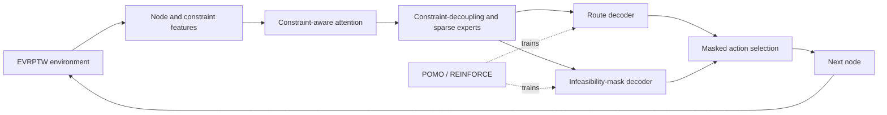

# CAT

**Constraint-Aware Transformer for the Electric Vehicle Routing Problem with Time Windows (EVRPTW)**

CAT is a reinforcement-learning solver for the EVRPTW, organized around the encoder-decoder interfaces used by RL4CO. It adds constraint-aware representations and feasibility prediction to an attention-based routing policy.

## Method overview

- **Constraint-aware encoder:** separates node and constraint features, applies constraint-aware attention (CAA), and uses a constraint-decoupling module with sparse expert routing.
- **Dual-level decoder:** constructs routes with a route decoder and predicts future infeasibility with an auxiliary mask decoder.
- **EVRPTW environment:** provides the problem state, action mask, instance generator, and route renderer.
- **RL4CO training components:** POMO and REINFORCE modules, plus the shared autoregressive-policy and environment abstractions required by CAT.



## Repository structure

```text
rl4co/
|-- envs/
|   |-- common/                 # RL4CO environment base and shared utilities
|   `-- routing/
|       |-- evrp/               # EVRP parent environment and generator
|       `-- evrptw/             # EVRPTW environment, generator, and renderer
|-- models/
|   |-- CAT/
|   |   |-- am/                 # CAT attention-model encoder, decoder, and policy
|   |   `-- pomo/               # CAT POMO training wrapper
|   |-- common/constructive/    # Constructive and autoregressive policy interfaces
|   |-- nn/                     # Attention, graph, MoE, and embedding modules
|   `-- rl/                     # REINFORCE and shared training components
|-- data/                       # Dataset and tensor transformation utilities
`-- utils/                      # Decoding, optimization, and runtime utilities
```

## Scope

This repository is a curated source snapshot containing CAT, its EVRPTW task, and the RL4CO components needed to understand the model architecture. The retained RL4CO source identifies version `0.5.0dev0`.

Training entry-point scripts, benchmark datasets, trained checkpoints, experiment logs, and a pinned dependency/environment file are not included in this snapshot. As a result, this repository documents and shares the model and environment implementation but is not currently a one-command reproduction package.

## License

This project is distributed under the MIT License. The retained RL4CO components include their upstream copyright and license notice in `LICENSE`.
